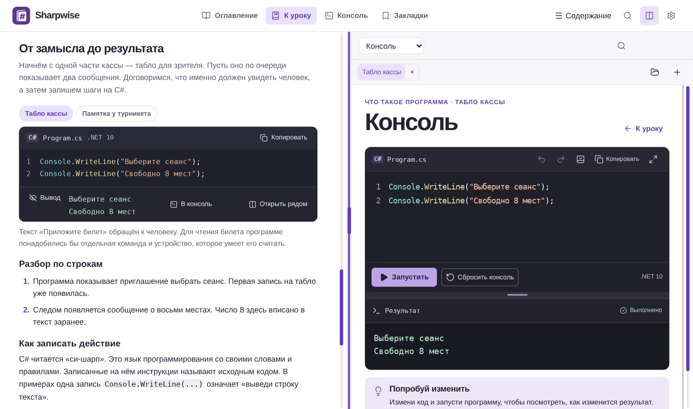
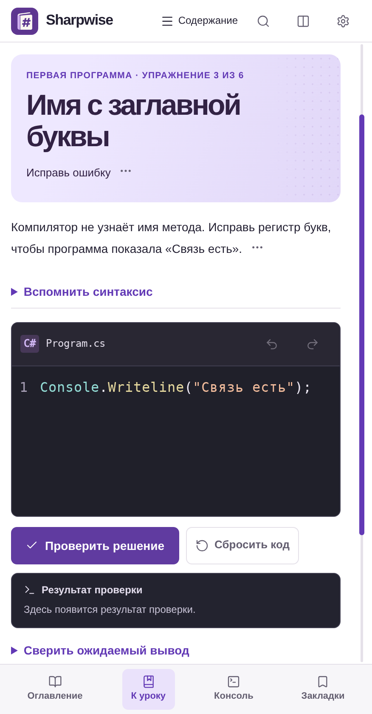
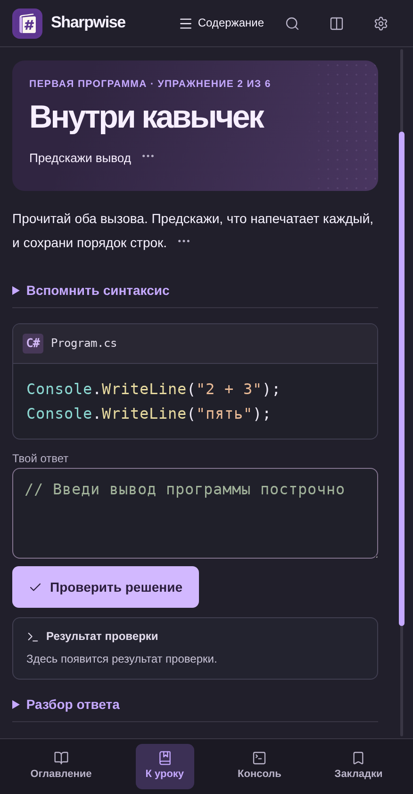

<p align="center">
  
</p>

<h1 align="center">Sharpwise</h1>

<p align="center"><strong>Интерактивный учебник C# с нуля</strong></p>
<p align="center">18 тем · 93 главы · 610 упражнений</p>

<p align="center">
  <strong><a href="https://github.com/MrBogomoll/Sharpwise/releases/download/v0.5.2/Sharpwise-0.5.2-Android.apk">Скачать для Android (.apk)</a></strong> ·
  <strong><a href="https://github.com/MrBogomoll/Sharpwise/releases/download/v0.5.2/Sharpwise-0.5.2-Windows-x64-Portable.zip">Скачать для Windows x64 (.zip)</a></strong> ·
  <a href="https://github.com/MrBogomoll/Sharpwise/releases/download/v0.5.2/Sharpwise-0.5.2-Web.zip">Веб-версия (.zip)</a>
</p>

<p align="center">
  <a href="https://github.com/MrBogomoll/Sharpwise/releases/tag/v0.5.2">Стабильная версия 0.5.2</a>
</p>



<details>
<summary>Упражнения на телефоне в светлой и тёмной темах</summary>

<p align="center">
  <a href="docs/screenshots/exercise-light.webp"></a>
  <a href="docs/screenshots/exercise-dark.webp"></a>
</p>

</details>

Научись писать на C# прямо на телефоне или компьютере. Ты начнёшь с первой строки с `Console.WriteLine` и соберёшь собственный трекер расходов с поиском и отчётами. Открой консоль рядом с уроком, измени пример и посмотри, что напечатает твоя программа. На Android и Windows уроки, упражнения и компилятор работают без интернета.

## Попробуй первый урок

В оглавлении выбери **Первые шаги → Что такое программа**. В примере «Табло кассы» всего две команды.

```csharp
Console.WriteLine("Выберите сеанс");
Console.WriteLine("Свободно 8 мест");
```

Нажми **«Открыть рядом»**, замени во второй строке текст в кавычках на `Мест больше нет` и нажми **«Запустить»**. В консоли появятся две строки, как на табло. Теперь поменяй команды местами. Какое сообщение зритель увидит первым?

В упражнениях тебе предложат предсказать вывод, найти ошибку или написать решение с нуля. В задачах с несколькими наборами данных кнопка **«Проверить решение»** покажет, на каком вводе разошлись ожидаемый и фактический ответы. Если забыл, что означает знак или команда, открой **«Вспомнить синтаксис»** прямо в задаче.

## Чему ты научишься

| Этап | Что сделаешь сам |
| --- | --- |
| Первые программы | Выведешь текст, прочитаешь ответ с клавиатуры и разберёшься, почему `"7"` и `7` ведут себя по-разному. |
| Условия, циклы и методы | Проверишь ввод, повторишь запрос при ошибке и вынесешь повторяющееся действие в метод. |
| Коллекции, классы и LINQ | Опишешь свои типы данных, соберёшь записи в список и отберёшь нужные для отчёта. |
| Проект на практике | Соберёшь трекер расходов. В нём можно добавлять траты, искать записи по категории и считать итоги. Готовый проект с тестами можно скачать и открыть на ПК. |

В конце каждой главы есть две задачи посложнее. Первая закрепляет материал главы, вторая предлагает совместить несколько знакомых приёмов. После основ можно отдельно изучать асинхронность, параллельные вычисления, работу с памятью и другие темы. [Подробный указатель тем и сравнение с METANIT](docs/course-coverage.md)

## Учиться в своём темпе

- **Код рядом с теорией.** Разверни редактор на весь экран или оставь его в соседней панели. Вывод можно скрыть или изменить его высоту. В редакторе есть отмена и повтор правок.
- **Свои программы.** Дай программе имя и убери её в черновики, чтобы позже открыть из папки. Вкладки можно закрывать, ненужные программы — отправлять в корзину.
- **Поиск и заметки.** Лупа ищет по теории, примерам и задачам без учёта регистра. Выдели фразу в уроке и нажми «Добавить заметку». В «Закладках» нажатие на цитату вернёт к этому месту.
- **Прогресс.** В оглавлении видно, сколько задач решено. В главе можно открыть список её решений, а в разделе «Решённые задачи курса» — найти свой код по всему учебнику.

## Установка и первый запуск

| Где заниматься | Как открыть Sharpwise |
| --- | --- |
| Android 9 и новее | Скачай APK на телефон и открой его. Для примеров на C# 15 нужен Android System WebView 137 или новее. |
| Windows x64 | Распакуй ZIP целиком и запусти `Sharpwise.exe` в папке `Sharpwise`. Нужна среда Microsoft Edge WebView2. |
| iPhone или iPad в одной сети с ПК | В настройках Windows-приложения нажми «Открыть доступ по Wi-Fi». Отсканируй QR-код камерой и оставь Sharpwise открытым на компьютере. |
| Браузер на Windows, Linux или macOS | Распакуй веб-архив. Установи ASP.NET Core Runtime 10 или .NET SDK 10. В папке архива выполни `dotnet CSharpBook.Server.dll` и открой `http://127.0.0.1:53821/`. |

На Android начиная с 0.5.1 и в Windows-сборке с `Sharpwise.exe` открой **Настройки → Проверить обновления**. Sharpwise покажет номер версии и размер файла. На Android установку подтверждает системный установщик. Если после установки он остался на экране, нажми «Открыть». На Windows приложение перезапустится само.

<details>
<summary>Переход со старых версий</summary>

**Android 0.5.0 или «Sharpwise · Тест» 0.3.5.** Начиная с 0.5.1 APK подписан новым ключом, поэтому для перехода потребуется переустановка. Сначала синхронизируй прогресс и убедись, что резервная копия доступна. Если в новой версии пока недоступен вход через Google, сохрани прогресс на Яндекс Диске. Затем удали старую версию, установи актуальный APK по ссылке выше, подключи диск с копией и восстанови прогресс.

**Android 0.2.0.** Актуальный Sharpwise установится рядом, со своим хранилищем.

**Windows с `CSharpBook.exe`.** Один раз закрой приложение, скачай ZIP по ссылке вверху и распакуй папку `Sharpwise` рядом со старой. Открой `Sharpwise.exe` в той же учётной записи Windows. Прогресс и настройки хранятся в профиле пользователя. Для дальнейших обновлений используй настройки приложения.

</details>

## Начать на телефоне и продолжить на компьютере

Прогресс сохраняется на устройстве. Для переноса между Android и Windows выбери **Настройки → Синхронизация** на обоих устройствах и подключи один аккаунт Google Диска или Яндекс Диска. Если на телефоне прочитаны первые пять глав, а на компьютере есть заметки к ним, после синхронизации на обоих устройствах будут и отметки о чтении, и заметки.

При первом подключении прогресс с диска загрузится автоматически. Если один черновик редактировали на обоих устройствах, в настройках можно сравнить оба варианта и выбрать нужный.

<details>
<summary>Подключение диска, таймер и резервная копия</summary>

- **Яндекс Диск.** Нажми «Подключить Яндекс Диск» и войди в свой аккаунт. Учебник хранит прогресс в папке приложения.
- **Google Диск.** На Android выбери аккаунт и разреши доступ к данным Sharpwise. Для входа в версиях Android с 0.5.1 приложение должно быть зарегистрировано в Google Cloud с новым сертификатом подписи. На Windows при первом подключении понадобится Client secret клиента Sharpwise Windows или сохранённый JSON этого клиента. [Настройка облачного подключения](docs/cloud-sync.md)
- **Частота обмена.** Можно синхронизировать при изменениях, по таймеру от 1 минуты до 99 часов 59 минут или вручную. Таймер работает, пока учебник открыт. Оба автоматических режима можно включать вместе.
- **Ручная загрузка.** «Синхронизировать сейчас» запускает обмен сразу. «Восстановить прогресс» повторно считывает сохранение с диска и объединяет его с локальным.
- **В браузере.** Прогресс хранится в текущем браузере. Для переноса в другой используй кнопки «Скачать копию» и «Восстановить из файла».

</details>

## Разработчикам

Обе оболочки используют один веб-интерфейс. Упражнения компилирует Roslyn. Базовые примеры работают на C# 14 и .NET 10, уроки по C# 15 используют .NET 11. Каждый запуск получает отдельный Web Worker и временную файловую систему.

<details>
<summary>Структура проекта</summary>

| Путь | Содержимое |
| --- | --- |
| [wwwroot/course.json](wwwroot/course.json) | Темы, главы, примеры и задания |
| [wwwroot](wwwroot) | Навигация, представления, оформление и хранение прогресса |
| [wwwroot/editor](wwwroot/editor) и [wwwroot/console.js](wwwroot/console.js) | Редактор CodeMirror, ввод и вывод |
| [runner](runner) и [wwwroot/runtime](wwwroot/runtime) | Сборка компилятора и две готовые среды WebAssembly |
| [wwwroot/projects](wwwroot/projects) | Архивы учебных проектов, включая решение с MSTest |
| [host](host), [server](server), [android](android) | Оболочка Windows, HTTP-сервер и оболочка Android |

</details>

<details>
<summary>Сборка и запуск из исходников</summary>

Для полной пересборки потребуются .NET SDK 10 и 11, Python 3 и Node.js. Команды ниже выполняются на Windows из корня репозитория.

```powershell
python runner/build.py
python tools/verify-course-projects.py
python tools/project-tree.py
node tools/verify-course.mjs
python tools/offline.py
dotnet publish host/CSharpBook.csproj -c Release -r win-x64 --self-contained true -p:PublishSingleFile=true -p:IncludeNativeLibrariesForSelfExtract=true -p:EnableCompressionInSingleFile=true -o dist/windows
```

Запусти `dist/windows/Sharpwise.exe` рядом с папкой `wwwroot`. Для тестового канала Windows добавь к команде публикации `-p:SharpwiseChannel=Preview`. Из тестового канала можно перейти на стабильный выпуск.

Для веб-сборки выполни `dotnet publish server/CSharpBook.Server.csproj -c Release -o dist/web`, скопируй `wwwroot` в `dist/web` и запусти `dotnet dist/web/CSharpBook.Server.dll`. Флаг `--lan` открывает сервер в локальной сети. Для установки веб-версии с офлайн-кэшем нужен HTTPS или localhost. После полной первой загрузки service worker сохраняет курс, редактор и обе среды выполнения. Для интерактивного ввода без общей памяти нужен серверный канал ввода.

При правке курса сохраняй идентификаторы опубликованных тем. После изменения архивов проектов перегенерируй дерево проекта. После изменений в `wwwroot` обнови офлайн-манифест командой `python tools/offline.py`.

[Сборка и подпись приложения для Android](android/README.md)

</details>

## Лицензия

Sharpwise распространяется по [лицензии MIT](LICENSE). У сторонних компонентов свои лицензии.
